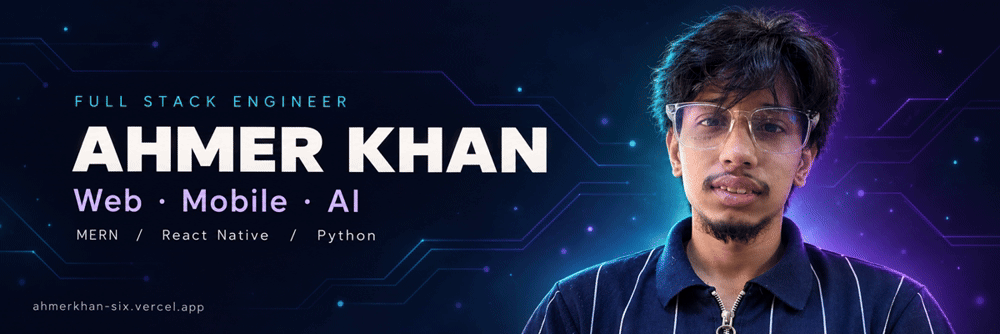

  

  <a href="https://ahmerkhan-six.vercel.app/">Portfolio</a> ·
  <a href="https://www.linkedin.com/in/ahmer-khan-8b895a230/">LinkedIn</a> ·
  <a href="mailto:khanahmer526@gmail.com">Email</a>

---

## 👨‍💻 About Me

I'm a software engineer building production-ready applications across web, mobile, and AI. I work with the **MERN stack**, **React Native**, and **Python**, connecting interfaces and backend services with payments, voice calls, streaming, and cloud storage.

- 🔭 Building full-stack applications and AI-powered tools
- 📱 Developing mobile apps with React Native
- ⚙️ Creating backend APIs with Node.js, Flask, and PHP
- 🧠 Exploring machine learning, computer vision, and multimodal search
- 🚀 Taking applications from development to production

## 🛠️ Technical Toolkit

| Area | Technologies |
| :--- | :--- |
| **Languages** | JavaScript (ES6+), TypeScript, Python, PHP, SQL |
| **Frontend** | React, Next.js, Tailwind CSS, HTML, CSS |
| **Mobile** | React Native |
| **Backend** | Node.js, Express.js, Flask, PHP |
| **Databases** | MongoDB, MySQL |
| **AI & Computer Vision** | TensorFlow, OpenCV, scikit-learn, Hugging Face, CLIP, ViT, DINOv2 |
| **Cloud & Deployment** | AWS S3, IAM, Hostinger VPS, domains and subdomains |

## 📌 Featured Projects

### 🔎 AI Fashion Recommendation System

A fashion discovery system that helps users find items through image and text search.

- Implemented multimodal search using **CLIP and DINO-based embeddings**
- Built feature extraction and similarity matching
- Developed a **Flask API with a MySQL backend**

### 📞 AI Cold Calling System

An AI-powered calling platform combining voice communication, speech processing, and CRM workflows.

- Integrated **Twilio and OpenAI** for AI-powered calls
- Used **NVIDIA Riva** for real-time speech processing
- Built CRM functionality backed by **MongoDB**

### 📊 Google Maps Lead Scraper

A business data collection tool designed to streamline lead generation.

- Extracted **1,000+ business leads**
- Added email scraping to enrich business records
- Optimized scraping performance and data collection workflows

## 🔌 Integrations & Deployment

| Capability | Hands-on Experience |
| :--- | :--- |
| **Payments** | Stripe, Authorize.Net |
| **Voice & Calling** | Twilio VoIP APIs |
| **Video Streaming** | Cloudflare Stream |
| **Push Notifications** | Firebase Cloud Messaging |
| **Cloud Storage & Access** | AWS S3, IAM roles and policies |
| **Production Deployment** | Hostinger VPS, domains, subdomains, environment configuration |

## ⚡ What I Build

- Full-stack web applications with connected interfaces, APIs, and databases
- Mobile applications using React Native
- AI-powered systems for search, recommendations, voice, and automation
- Business applications handling users, payments, and live data

## 📅 Contribution Calendar

  

## 🔥 Contribution Streak

  

## 📊 GitHub Stats

  

## 💻 Most Used Languages

  

  Cards update periodically. Contributions and commits measure different activity; private repository data may not be included. Language statistics reflect repository code, rather than proficiency.

---

## 🤝 Let's Connect

Have a project involving full-stack development, mobile apps, or AI? Let's talk.

- 🌐 **Portfolio:** [ahmerkhan-six.vercel.app](https://ahmerkhan-six.vercel.app/)
- 💼 **LinkedIn:** [Ahmer Khan](https://www.linkedin.com/in/ahmer-khan-8b895a230/)
- 📧 **Email:** [khanahmer526@gmail.com](mailto:khanahmer526@gmail.com)
